> [!WARNING]
> Boji 仍在开发中，iOS 和 Android 两端都尚未上架。

<p align="center">
    <picture>
        <source media="(prefers-color-scheme: dark)" srcset="assets/public/boji-icon-dark.png">
        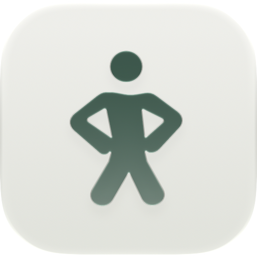
    </picture>
</p>

<h1 align="center">Boji · 薄肌俱乐部</h1>

<p align="center"><strong>穿衣显瘦，脱衣有肉<br/>把薄肌理论落到每天的训练、饮水和睡眠里</strong></p>

<div align="center">
    
    
    
    <a href="https://twitter.com/AprilNEA" target="_blank">
    </a>
    
</div>

<p align="center">支持 iPhone、Apple Watch 和 Android 手机。</p>

---

## 薄肌理论

- **薄肌**：穿衣显瘦，脱衣有肉。体脂长期保持在 13% 以下，不吃欺骗餐。
- **黄毛**：不被外界评价左右，坚持自己判断过的方向。
- **大水**：成年男性每天喝 1700 mL 水，成年女性每天 1500 mL 起。
- **大睡**：每晚睡 7 小时～9 小时，不靠周末补觉。

## 功能

<table>
    <tr>
        <td align="center" width="33%">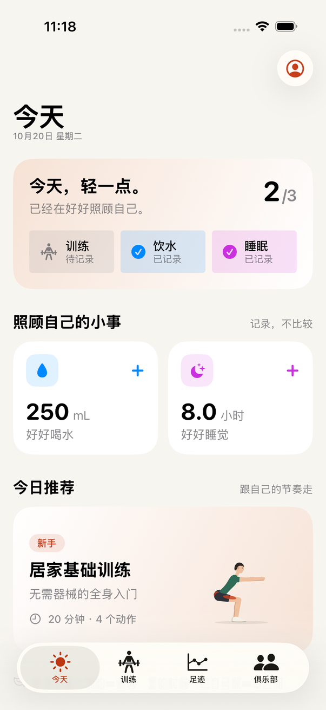</td>
        <td align="center" width="33%">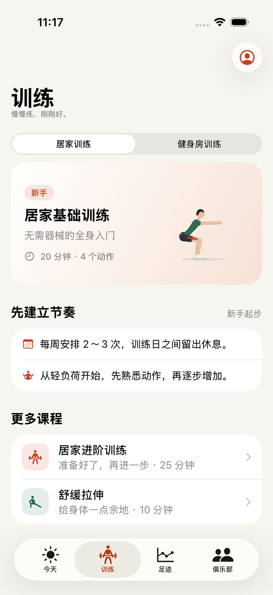</td>
        <td align="center" width="33%">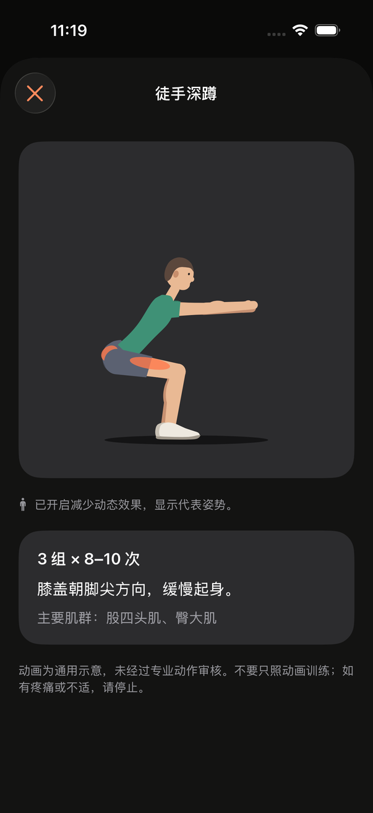</td>
    </tr>
    <tr>
        <td align="center"><b>每日打卡</b><br><sub>训练、饮水、睡眠一眼看清</sub></td>
        <td align="center"><b>课程</b><br><sub>居家或健身房，按场景推荐</sub></td>
        <td align="center"><b>动作说明</b><br><sub>动画标出发力肌群</sub></td>
    </tr>
    <tr>
        <td align="center">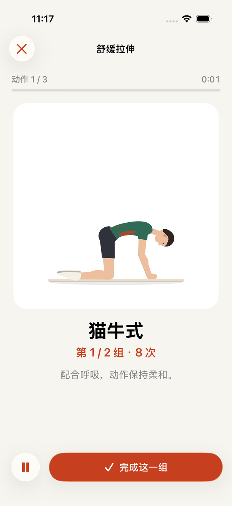</td>
        <td align="center">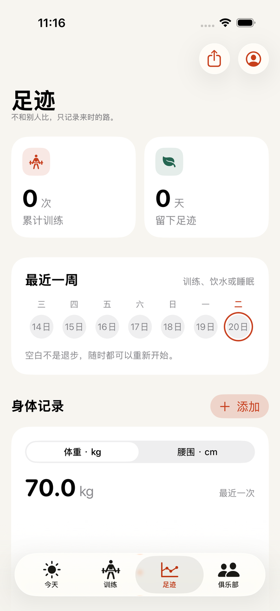</td>
        <td align="center">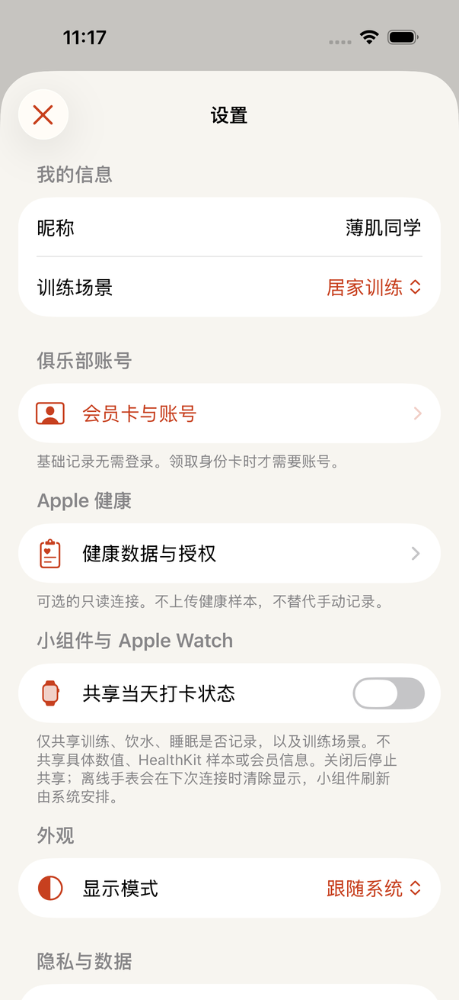</td>
    </tr>
    <tr>
        <td align="center"><b>跟练</b><br><sub>逐组计数，自动休息倒计时</sub></td>
        <td align="center"><b>足迹</b><br><sub>训练记录和体重、腰围趋势</sub></td>
        <td align="center"><b>设置</b><br><sub>健康数据、小组件与手表</sub></td>
    </tr>
</table>

### 每天三件事

Boji 把薄肌理论拆成每天三项打卡：**训练**、**饮水**和**睡眠**。

- 今天页显示三项的完成情况，并推荐一套当天的课程。
- 饮水逐次累加，睡眠记录时长，点一下就能记。
- 主屏幕小组件和手表也能看到当天的打卡状态。

### 课程与跟练

App 内置 4 套课程、16 个动作，居家徒手和健身房器械都有：

<table>
    <tr>
        <th>课程</th>
        <th colspan="5">动作</th>
    </tr>
    <tr>
        <td><b>居家基础训练</b><br><sub>无需器械的全身入门<br>20 分钟，4 个动作</sub></td>
        <td align="center"><picture><source media="(prefers-color-scheme: dark)" srcset="assets/public/previews/course/dark/bodyweight-squat.png">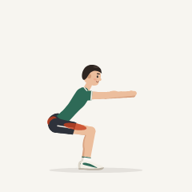</picture><br><sub>徒手深蹲</sub></td>
        <td align="center"><picture><source media="(prefers-color-scheme: dark)" srcset="assets/public/previews/course/dark/wall-push-up.png">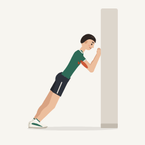</picture><br><sub>墙壁俯卧撑</sub></td>
        <td align="center"><picture><source media="(prefers-color-scheme: dark)" srcset="assets/public/previews/course/dark/glute-bridge.png">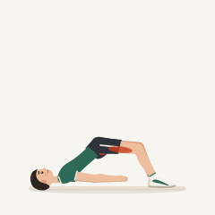</picture><br><sub>臀桥</sub></td>
        <td align="center"><picture><source media="(prefers-color-scheme: dark)" srcset="assets/public/previews/course/dark/bird-dog.png">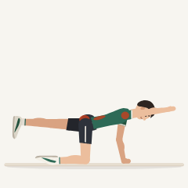</picture><br><sub>鸟狗式</sub></td>
        <td></td>
    </tr>
    <tr>
        <td><b>居家进阶训练</b><br><sub>基础训练之后的下一步<br>25 分钟，5 个动作</sub></td>
        <td align="center"><picture><source media="(prefers-color-scheme: dark)" srcset="assets/public/previews/course/dark/reverse-lunge.png">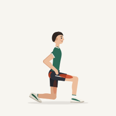</picture><br><sub>后撤步弓步蹲</sub></td>
        <td align="center"><picture><source media="(prefers-color-scheme: dark)" srcset="assets/public/previews/course/dark/knee-push-up.png">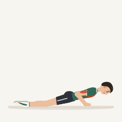</picture><br><sub>跪姿俯卧撑</sub></td>
        <td align="center"><picture><source media="(prefers-color-scheme: dark)" srcset="assets/public/previews/course/dark/dead-bug.png">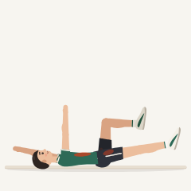</picture><br><sub>死虫式</sub></td>
        <td align="center"><picture><source media="(prefers-color-scheme: dark)" srcset="assets/public/previews/course/dark/wall-sit.png">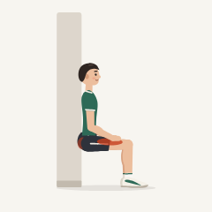</picture><br><sub>靠墙静蹲</sub></td>
        <td align="center"><picture><source media="(prefers-color-scheme: dark)" srcset="assets/public/previews/course/dark/plank.png">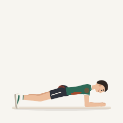</picture><br><sub>平板支撑</sub></td>
    </tr>
    <tr>
        <td><b>器械基础训练</b><br><sub>轻重量熟悉常用器械<br>30 分钟，4 个动作</sub></td>
        <td align="center"><picture><source media="(prefers-color-scheme: dark)" srcset="assets/public/previews/course/dark/chest-press.png">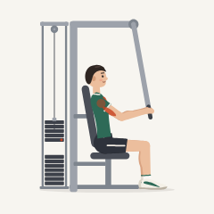</picture><br><sub>坐姿推胸</sub></td>
        <td align="center"><picture><source media="(prefers-color-scheme: dark)" srcset="assets/public/previews/course/dark/seated-row.png">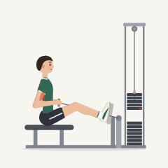</picture><br><sub>坐姿划船</sub></td>
        <td align="center"><picture><source media="(prefers-color-scheme: dark)" srcset="assets/public/previews/course/dark/leg-press.png">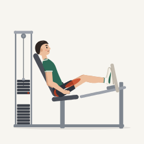</picture><br><sub>坐姿腿举</sub></td>
        <td align="center"><picture><source media="(prefers-color-scheme: dark)" srcset="assets/public/previews/course/dark/lat-pulldown.png">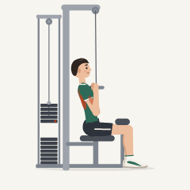</picture><br><sub>高位下拉</sub></td>
        <td></td>
    </tr>
    <tr>
        <td><b>舒缓拉伸</b><br><sub>训练前后都可进行<br>10 分钟，3 个动作</sub></td>
        <td align="center"><picture><source media="(prefers-color-scheme: dark)" srcset="assets/public/previews/course/dark/cat-cow.png">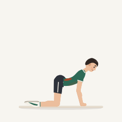</picture><br><sub>猫牛式</sub></td>
        <td align="center"><picture><source media="(prefers-color-scheme: dark)" srcset="assets/public/previews/course/dark/hip-flexor-stretch.png">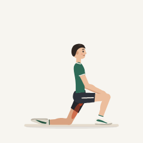</picture><br><sub>髋屈肌拉伸</sub></td>
        <td align="center"><picture><source media="(prefers-color-scheme: dark)" srcset="assets/public/previews/course/dark/chest-stretch.png">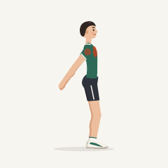</picture><br><sub>开胸拉伸</sub></td>
        <td></td>
        <td></td>
    </tr>
</table>

<table>
<tr>
<td width="35%" align="center"><picture><source media="(prefers-color-scheme: dark)" srcset="assets/public/previews/course/dark/bodyweight-squat.gif">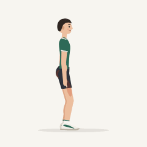</picture></td>
<td valign="middle">

- **动作动画**：每个动作都有循环动画，用颜色标出主要发力的肌群，跟随系统切换深浅色。
- **动作要点**：动作说明列出组数、次数、要点和主要肌群。
- **逐组跟练**：完成一组后自动开始 30 秒休息倒计时，可以跳过，也可以随时暂停。
- **按场景推荐**：首次打开时选择居家或健身房，训练页据此推荐课程，之后随时切换。

</td>
</tr>
</table>

### 足迹

- 累计训练次数、活跃天数和最近 7 天的记录。
- 体重和腰围的趋势图，可以手动添加，也可以从系统健康数据读取。
- 一键通过系统分享面板分享足迹。

### 俱乐部与会员卡

- 每周挑战，以及训练、饮食和休息三篇入门文章。
- 用邮箱账号登录、确认俱乐部守则后，可以领取免费会员卡。
- 分享会员卡图片时可以选三种配色，卡号默认隐藏。

### 手表、小组件与健康数据

- **小组件和手表**：开启「共享当天打卡状态」后，在主屏幕和手表上查看当天三项是否完成。只共享是否完成，不共享具体数值。
- **健康数据**：只读连接 Apple 健康或 Health Connect，读取体重、睡眠等数据，与手动记录分开显示。

以上两项都默认关闭。

### 数据留在手机上

- 训练、打卡和足迹都保存在本机，不需要注册账号。
- 只有领取会员卡时才需要登录。
- 设置页可以把全部记录导出为 JSON，也可以一键删除全部本地数据。

### 平台支持

两端的课程、打卡、足迹、俱乐部和会员卡功能相同，系统集成各有不同：

| 功能 | iOS | Android |
| --- | --- | --- |
| 健康数据（只读） | Apple 健康：体重、腰围和睡眠 | Health Connect：体重和睡眠 |
| 小组件 | 主屏幕和锁定屏幕 | 主屏幕 |
| 手表 | Apple Watch | Wear OS |
| 系统账号登录 | Apple 登录（服务端开放后可用） | 尚未支持 |
| 钱包会员卡 | Apple Wallet（服务端开放后可用） | 尚未支持 |

无障碍支持情况见[无障碍说明](docs/ACCESSIBILITY.md)。课程和动作动画是通用参考，不提供医疗诊断。

### 大学排名（计划中）

大学排名比较的是每所学校有多少薄肌会员，不给个人排名，也不比体重、照片或训练量。

- **怎样计入**：持有会员卡的会员，用学校邮箱收一次验证码，就计入本校人数。认证一年有效，可以随时续期或退出。
- **怎样排序**：人数多的学校在前。人数相同时，先凑齐当前人数的学校在前。排名页还显示每所学校的本周新增人数。
- **保护隐私**：公开页面只显示每所学校的人数，不显示会员名单。不足 3 人的学校不公开显示。
- **哪些学校**：学校名单以公开的 [university-domains-list](https://github.com/hipo/university-domains-list) 为准。

排名会先在网站上线，App 入口之后再加。完整规则见[大学排名说明](https://leanmuscle.club/docs/guide/school-ranking/)，上线前可能调整。

### 动作库（开发中）

仓库里还有一个含 1567 个动作的动作库，覆盖徒手、哑铃、杠铃、壶铃、绳索、固定器械、弹力带等训练方式，尚未编入 App 课程。下面是其中 8 个动作：

<table>
    <tr>
        <td align="center" width="25%"><picture><source media="(prefers-color-scheme: dark)" srcset="assets/public/previews/library/dark/barbell-bench-press.gif">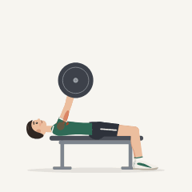</picture><br><sub>杠铃卧推</sub></td>
        <td align="center" width="25%"><picture><source media="(prefers-color-scheme: dark)" srcset="assets/public/previews/library/dark/dumbbell-standing-lateral-raise.gif">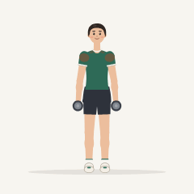</picture><br><sub>哑铃站姿侧平举</sub></td>
        <td align="center" width="25%"><picture><source media="(prefers-color-scheme: dark)" srcset="assets/public/previews/library/dark/cable-rope-seated-row.gif">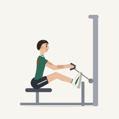</picture><br><sub>绳把坐姿划船</sub></td>
        <td align="center" width="25%"><picture><source media="(prefers-color-scheme: dark)" srcset="assets/public/previews/library/dark/barbell-romanian-deadlift.gif">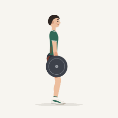</picture><br><sub>杠铃罗马尼亚硬拉</sub></td>
    </tr>
    <tr>
        <td align="center" width="25%"><picture><source media="(prefers-color-scheme: dark)" srcset="assets/public/previews/library/dark/kettlebell-goblet-squat.gif">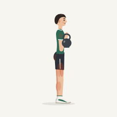</picture><br><sub>壶铃高脚杯深蹲</sub></td>
        <td align="center" width="25%"><picture><source media="(prefers-color-scheme: dark)" srcset="assets/public/previews/library/dark/ab-wheel-kneeling-rollout.gif">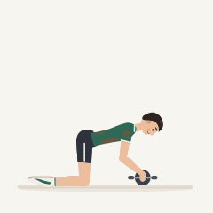</picture><br><sub>跪姿健腹轮</sub></td>
        <td align="center" width="25%"><picture><source media="(prefers-color-scheme: dark)" srcset="assets/public/previews/library/dark/kettlebell-swing.gif">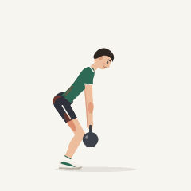</picture><br><sub>壶铃摆荡</sub></td>
        <td align="center" width="25%"><picture><source media="(prefers-color-scheme: dark)" srcset="assets/public/previews/library/dark/worlds-greatest-stretch.gif">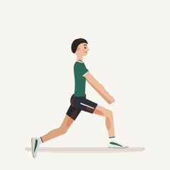</picture><br><sub>世界最佳拉伸</sub></td>
    </tr>
</table>

| 类型 | 动作数 | 示例 |
| --- | ---: | --- |
| 上肢推 | 365 | 上斜卧推、阿诺德推举、俯卧撑、侧平举、臂屈伸 |
| 上肢拉 | 423 | 引体向上、高位下拉、俯身划船、牧师凳弯举 |
| 下肢 | 278 | 深蹲、罗马尼亚硬拉、弓步蹲、臀推、提踵 |
| 核心 | 176 | 卷腹、俄罗斯转体、平板支撑、体侧屈 |
| 爆发力与体能 | 174 | 杠铃翻举、壶铃摆荡、分腿蹲跳、农夫行走 |
| 拉伸与放松 | 146 | 腘绳肌拉伸、关节绕环、泡沫轴放松 |
| 其他 | 5 | 平衡板站立 |

动画的生成与校验方式见[动作动画说明](animations/README.md)。使用动作库须另行取得商业授权，见[许可证](#许可证)。

## 参与开发

本仓库包含 iOS 与 Android 两个原生客户端、Rust 后端、两端共用的动作动画与文案，以及薄肌俱乐部宣传网站，各目录独立构建。目录结构、工具链与本地运行方式详见[开发指南](docs/DEVELOPMENT.md)。

外部贡献者必须先签署[贡献者许可协议](.github/CLA.md)（CLA），其 Pull Request 方可合并。签署方式为在 Pull Request 中原样评论以下文字：

```text
I have read the CLA Document and I hereby sign the CLA
```

依据该协议，贡献者保留其贡献的著作权，并授权 AprilNEA LLC 以包括商业条款在内的任意条款分发其贡献。

## 许可证

本仓库的代码与文档由 AprilNEA LLC 依据 [PolyForm Noncommercial License 1.0.0](LICENSE.md) 授权，仅限非商业使用。

下列内容不适用该许可证，其权利归各自的权利人所有：

| 内容 | 目录 |
| --- | --- |
| App 图标 | `ios/Boji/Resources/AppIcon.icon`、`assets/public/boji-icon.png`、`assets/public/boji-icon-dark.png`、`bizserver/assets/wallet/icon*.png` |
| 网站媒体 | `websites/public/media/` |
| 人像照片 | `websites/public/images/portraits/` |
| App 截图 | `assets/public/screenshots/` |
| 动作库 | `animations/src/exercises/library/`、`assets/public/previews/library/` |
| Apple Root CA 证书 | `bizserver/assets/wallet/apple-root-ca.crt` |
| 第三方依赖与字体 | — |

如需使用动作库，须另行取得 AprilNEA LLC 的商业授权。
